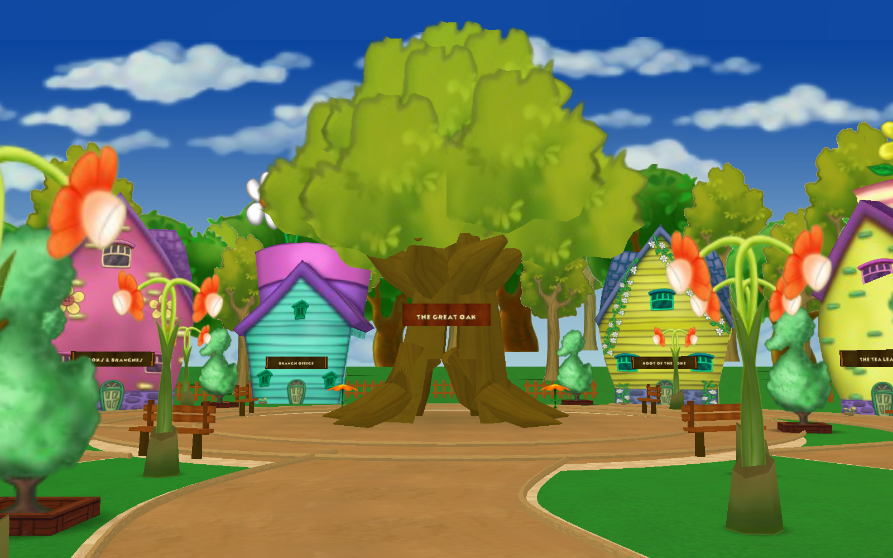

# Acorn Acreside / Root Route — first native art pass

These two locations now use authored DNA layouts, original textured Toontown
modules, and custom modeled terrain, a hollow Great Oak, benches, fences, signs,
and solid building backs. The other expansion locations still use the earlier
prototype art.




## Layouts and models

- `dna/acorn_acreside.dna`: woodland playground, loop path, eight storefronts,
  picnic areas, forest perimeter, and two tunnel exits.
- `dna/root_route.dna`: winding street with twelve storefronts, sidewalks, two
  small courtyards, and tunnels to Daisy Gardens and Acorn Acreside.
- `dna/storage_acorn.dna`: model aliases used by both layouts.
- `models/*.bam.pz`: compressed, ready-to-load Panda3D models. Models reference
  textures in the existing resources checkout; no resource repository changes.
- `../../tools/build_acorn_models.py`: deterministic mesh/UV/collision sources.
  Rebuilding models does **not** overwrite edited DNA placements.

The game uses its normal C++ DNA loader. Standard-Panda3D previews use a strict
reader for this layout's group/visgroup/prop subset. That preview reader is not
used by the running game. The C++ loader/editor GUI need the custom engine.

Stock landmark modules are used as scenery props, with added doors, signs,
building backs and collision volumes. They do not yet have working interiors or
NPCs. Root Route remains a peaceful exploration street; Cog paths and battle
cells have not been added. Tree canopies use textured billboard foliage, matching
the original game's tree convention; trunks, roots and branches are custom mesh.

## Open in OpenLevelEditor

1. Set up [OpenLevelEditor](https://github.com/OpenToontownTools/OpenLevelEditor)
   with the engine and phase resources described in its README. Its current
   `imgui` branch has separate requirements from the game's Python environment.
2. Copy `editor/AC.json` into the editor's `leveleditor/hoods/` folder (or the
   `hoods/` directory under your configured `userfiles-directory`).
3. Add the absolute path to this **game repository root** to the editor's
   `userconfig.prc`, for example:

   ```text
   model-path /Users/jacksonfoster/Desktop/open-toontown
   ```

   Also mount the game's `resources` folder if it is not already mounted by your
   editor setup. Keep the original stock resources configured as its README
   requires; the Acorn kit references those assets by their usual phase paths.
4. Start the editor with its compatible Python: `python ttle.py --hoods AC`.
5. Open `assets/acorn/dna/acorn_acreside.dna` or `root_route.dna` from this repo.
   Save into that same file, then reload the game location to see the change.

Use the built-in `AC` storage aliases for placing the kit's models. Storefronts
are grouped, so the facade, sign, door, backing and collision move together.
Keep `linktunnel_*` names and their nested native tunnel intact. If moving a
tunnel origin, update `ExpansionGlobals.gate_transforms` and its approach path
as well. Scene coordinates and prop transforms are in the DNA, not a second
generated layout file.

## Build and check

From the game root, with standard Panda3D and the resources checkout:

```sh
python tools/build_acorn_models.py
python tools/preview_acorn.py
python -m unittest discover -s tests -v
```

The preview defaults to offscreen EGL; use `--display p3tinydisplay` if that is
unavailable. These are renders of the committed models and DNA, not concept art.

To check the editor grammar (requires `ply` in this Python environment):

```sh
python tools/validate_acorn_dna.py --editor /path/to/OpenLevelEditor
```

With the game's custom Panda3D build installed, the native loader smoke check is:

```sh
python tools/validate_acorn_dna.py --native
```

The authored path samples, all four tunnel arrivals, oak passage, asset textures
and shared travel rules were checked here. The full editor GUI and custom-engine
client were not run here. Please keep this art pass in draft until an in-game
walkthrough checks camera motion, model loading and travel in the actual client.

## Asset provenance

Mesh code, layouts, model assembly and signs in this directory were created for
this expansion. Existing building modules, props, texture images, fonts and sky
are referenced from the project's original Open-Toontown resources. No source
from OpenLevelEditor is vendored into the game; its DNA format and parser were
used for interoperability and validation.
