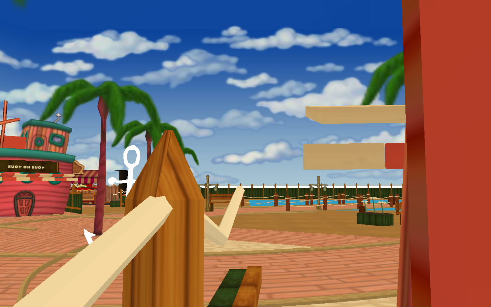
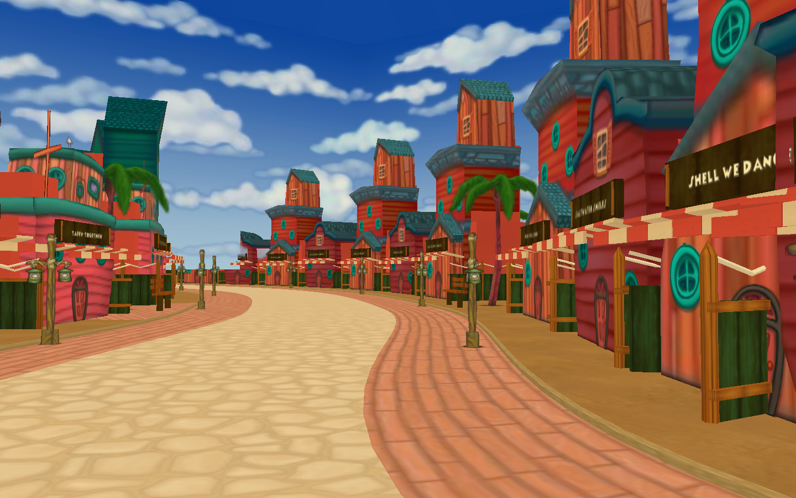
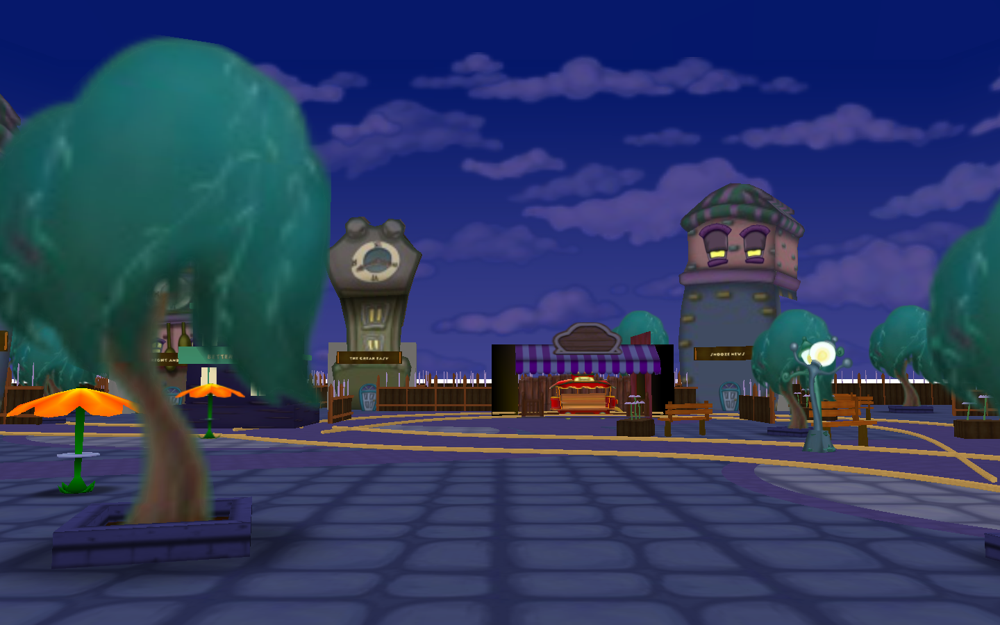
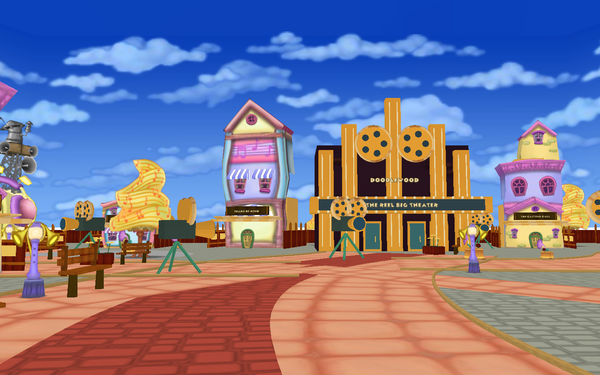
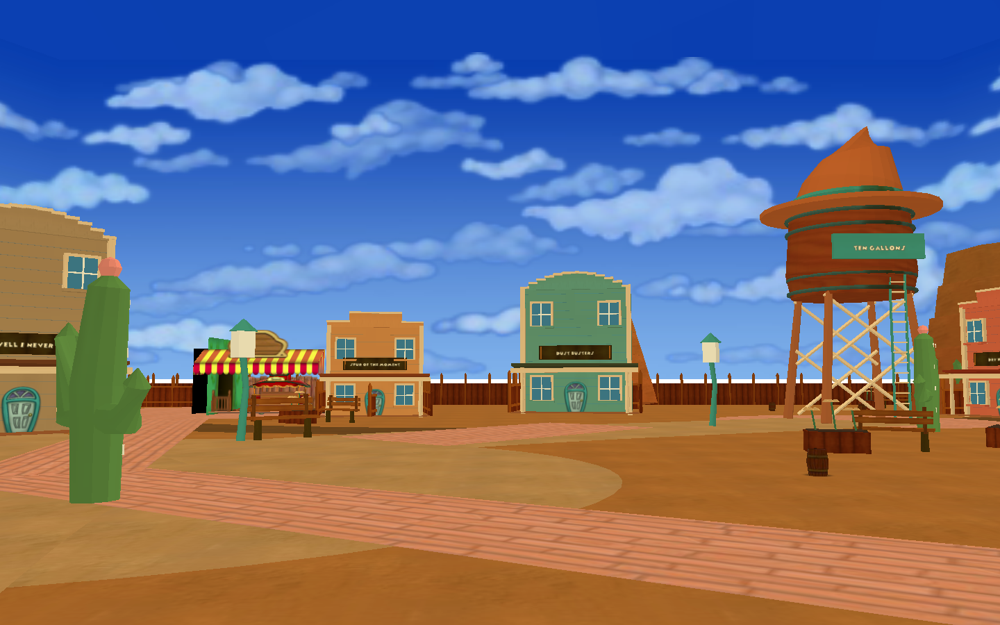
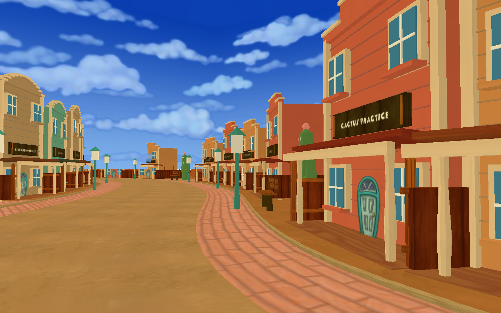

# Expanded Toontown art kit

All five expansion playgrounds and eight connecting streets now use native DNA
layouts. Acorn Acreside retains the woodland kit in `../acorn`; Root Route now
uses `dna/root_route.dna` and the shared world palette. Every exterior has a Toon
HQ. Gag shops and trolleys appear only in the five playgrounds.

| Location | Design |
| --- | --- |
| Briny Boardwalk | Dock storefronts, striped Loopy Lighthouse, boardwalk, lagoon, rope rails, palms and barrels |
| Hush Hollow | Dreamland storefronts, crooked Backwards Clock Tower, teal trees and sleepy garden courts |
| Doodlewood Studios | Melodyland storefronts, custom art-deco Reel Big Theater, film-camera props and red carpet |
| Tumbleweed Terrace | Custom western shops, deep porches, cactus props, sandstone mesas and Ten Gallon Water Tower |
| Bramble Bend | Woodland street transitioning into Hush Hollow |
| Taffy Terrace | Long dockside street with boardwalk sidewalks and palms |
| Limelight Lane | Coastal storefronts transitioning into studio architecture |
| Forty Winks Way | Long winding Dreamland-style street with garden rest stops |
| Encore Avenue | Curving musical/studio street with camera props |
| Stagecoach Street | Studio storefronts transitioning into western shops and mesas |
| Detour Drive | Long desert street, timber sidewalks and western porches |

The eight roads span roughly 930–1,190 units between tunnel mouths before their
curves are included. Each has its own centerline, paired native tunnel approaches,
shop rows, sidewalks, lamps and rest courts. Themed fences surround playgrounds
and screen building backs; services retain open door and boarding approaches.
Grounded props sit on level terrain, with distinct surface materials per theme.

Native DistributedSuitPlannerAI populations follow generated, connected, two-way
lanes in `patrols/`. Streets use the stock battle UI/state handlers; decorative
storefronts remain scenery and cannot be taken over. These gameplay changes still
require a live custom-engine client/AI walkthrough.

## Screenshots

These are offscreen Panda3D renders of the committed scenes, not concept art.









## Edit in OpenLevelEditor

Use the editor's compatible Panda3D build and the game's original phase resources.
Add this repository root to `model-path`, copy `editor/WX.json` to the editor's
hood configuration directory, and start with `python ttle.py --hoods WX`.
Open any layout under `dna/`. `storage_world.dna` declares its model palette.
The matching `services/service_ZONE.dna` contains the native service buildings
and trolley; load `services/storage_services.dna` for that palette.
The game loads model catalogs through Panda's Python loader and registers each
node in native DNAStorage; layouts and door triggers still use the C++ DNA loader.
This bypasses the Mac crash observed inside native storage-file loading and logs
the specific model if lower-level loading fails. Standard-Panda3D tooling uses the
same strict preview reader as the Acorn kit. The custom-engine client/editor GUI
were not run for this update.

The committed DNA is the runtime source of placement. Move or rotate props and
storefront groups there. Keep the nested native tunnel origin/trigger transforms
and `linktunnel_*` names intact. Moving a tunnel requires updating the matching
travel transforms in `WorldLayout.py` / `ExpansionGlobals.py`.

- `tools/build_world_models.py`: builds custom meshes and complete storefront kits.
- `tools/author_world_layouts.py`: initial placement recipe. **Overwrites DNA**;
  run only when deliberately replacing authored layouts.
- `tools/author_services.py`: authors all 13 service layouts and clears scenery
  from their footprints. Rebuild terrain after moving service bays.
- `tools/preview_world.py`: walking-height and overview screenshots.
- `tools/preview_expansion_ui.py`: actual map/admin widgets with a mock avatar.

Model rebuilding does not overwrite DNA layouts. Compressed BAM files store
relative phase texture references, so no resource repository changes are needed.
The generated terrain follows the centerlines in `WorldLayout.py`; changes to
those centerlines require intentionally regenerating terrain and placements.

## World map

The map opens directly on one illustrated world. Original playgrounds, Cog HQs,
MiniGolf and all five expansion neighborhoods have labeled travel buttons.
There is no additional map/reveal button. Hovering a new neighborhood shows its
connecting street names, without connecting lines. Current location, locked
travel, unavailable districts and safe mode remain explicit; the existing server
teleport-access check is preserved. Home/playground return buttons stay available
in the book when permitted. The separate admin panel still provides direct street
teleports and max-Toon controls.

`WorldMapData.py` supplies precise pin anchors and road curves. New-road endpoints
come from the same tunnel manifest used by travel; original connections were read
from the stock DNA. The generated background is illustrative; it does not define
routes or click targets.

## Provenance and validation scope

Original facade modules, trees, lamps, doors, fonts and textures are referenced
from the project's phase resources. New models include the lighthouse, clock
tower, theater, water tower, western shops, cacti, mesas, rope rails, cameras,
terrain, building backs and signs. Map artwork was generated with the built-in
image-generation tool using the original map as a style reference, then integrated
as `maps/toontown_world.png`. The prompt requested a text-free expanded Toontown
painting with all five new districts and the original regions; exact geographic
labels and routes are supplied by code.

Per the requested workflow, no automated test suite was run for this update.
Screenshots were rendered for visual iteration. Live multiplayer travel and the
custom-engine runtime still need an in-game walkthrough.

## Services and rebuilding

All five playgrounds and eight streets have a native Toon HQ with four quest
officers. Only playgrounds have a gag shop with two clerks and a multiplayer
trolley. Native interior/exterior door wiring and minigame return routing remain.
Interiors reserve exterior + 520 for HQs and exterior + 519 for playground shops.

From the game root, deliberately regenerating layouts uses this order:

```sh
python tools/build_world_models.py
python tools/author_world_layouts.py
python -m tools.ground_world
python tools/author_cog_patrols.py
python tools/preview_world.py
```

`world_dressing.py` defines each fence treatment and the shared prop kits.
`ground_world.py` bakes grounded aliases, so rerun it after layout authoring.
For Acorn terrain changes, build `build_acorn_models.terrain()` and save it as
`acorn_terrain`; the legacy Root Route models in that kit are not used at runtime.
Controls live in `otp/avatar/ToonWalker.py`: Shift accelerates normal walking and
physical left/right arrow polling preserves air steering during Ctrl-jumps.
