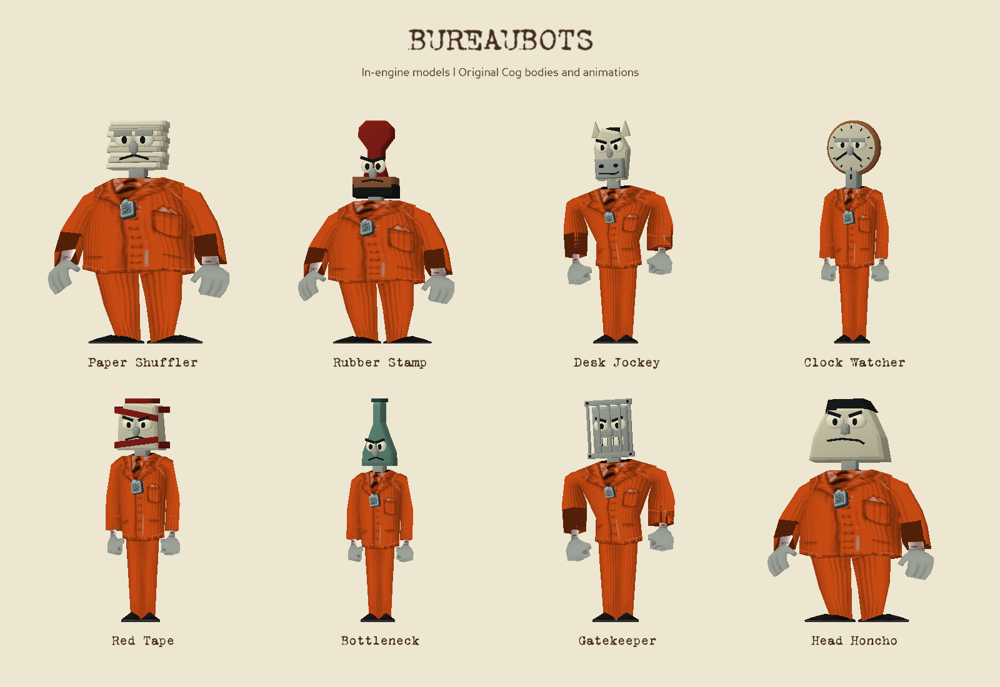
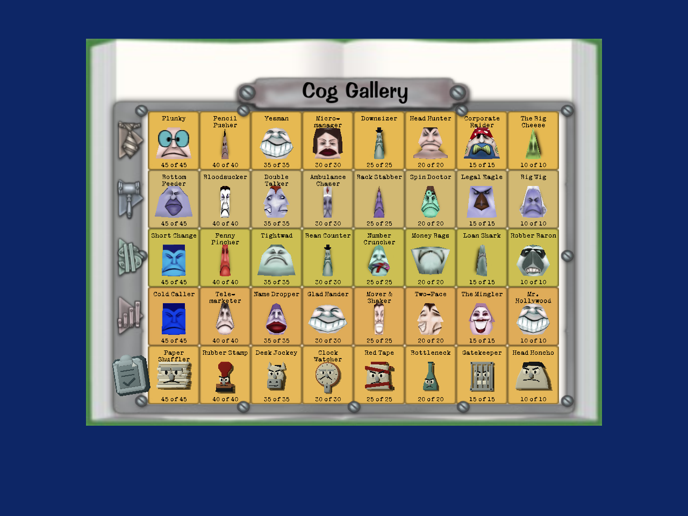
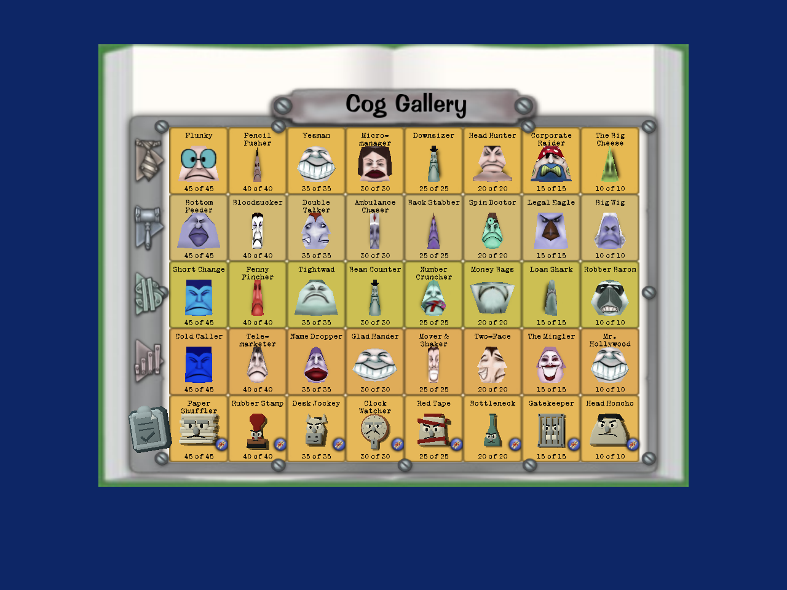
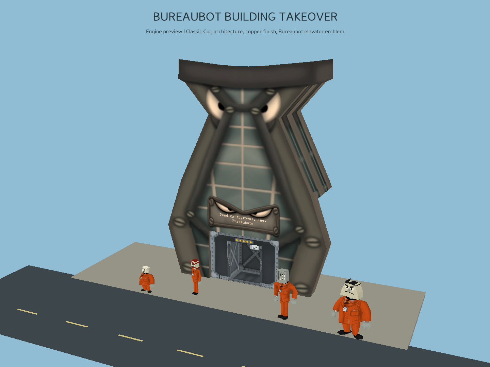

# Bureaubots

Eight bureaucracy-themed Cogs integrated as department `u`, below Sellbots.
They wear burnt-orange pinstripes with silver clipboard chest badges, and
occupy classic Cog buildings with a warm copper finish.

These are actual Panda3D assets and production gallery renders. The gallery
uses a local avatar/service adapter; the street scene is staged with the
production facade. They are not captures from a connected multiplayer session.
The original [concept sheet](concepts/bureaubots-lineup.png) is retained as design history.

## Roster and combat

| Rank | DNA | Cog | Move pool |
| --- | --- | --- | --- |
| 1 | ps | Paper Shuffler | Shred, Clip-On Tie, Pound Key |
| 2 | rst | Rubber Stamp | Rubber Stamp, Finger Wag, Watercooler |
| 3 | dj | Desk Jockey | Rolodex, Rubber Stamp, Double Talk |
| 4 | cw | Clock Watcher | Hang Up, Write Off, Spin |
| 5 | rt | Red Tape | Red Tape, Finger Wag, Mumbo Jumbo |
| 6 | bn | Bottleneck | Fill With Lead, Paradigm Shift, Write Off |
| 7 | gk | Gatekeeper | Restraining Order, Eviction Notice, Glower Power |
| 8 | hho | Head Honcho | Power Trip, Schmooze, Pink Slip |

Each uses the corresponding classic Bossbot rank's HP, defense, base accuracy
and level distribution. Three compatible moves are selected by the existing
AI's weighted random selector on every turn. Probabilities shift from
50/30/20 to 30/30/40 across the five relative levels; damage and accuracy rise
with level. Pools are deterministic shared data, avoiding client/server drift.
Animations, props, hit reactions and attack sounds use the existing movie
implementations. Regular and skeletal voices reuse the existing Cog audio.
Rubber Stamp uses a C body so its real stamp animation binds; Red Tape uses a
B body so its throwing animation binds.

The normal Suit class supplies collisions, nametags/levels, health meters,
flying/walking, joining battles, gag reactions, defeat actors and Skelecogs.
The standard reward and task paths accept all 40 types. Generic Cog, level,
recovery and building tasks count eligible Bureaubot defeats; department-name
and skeleton-name mappings also accept `u`.

## Gallery and summons

All five rows use the same cards, quota labels, discovery states, gold
completion colors, Cog radar, building radar and SummonCogDialog.
The former `View model` footer is removed. The new emblem is a monochrome,
embossed pewter clipboard shared with the models and building.

The previously empty `CogPageManagerAI` now records encounters and eligible
defeats for every department. It excludes nonparticipants, virtual enemies
and boss records. Counts cap at the existing per-rank quotas. Completing the
first quota for a whole department unlocks Cog radar; completing the second
unlocks building radar.

First reaching a Cog's final quota awards one single-Cog, building and
invasion summon. These are consumable using the normal server checks and are
not replenished by subsequent kills. CJ awards and restock can award them
again. The existing max-Toon command now maxes all five gallery rows and
restocks all 40 summon entries. Already-saved legacy completion is preserved;
loading a save does not repeatedly grant free summons.

Single summons call the street planner with the selected DNA name. Building
summons use the existing closest eligible shop and takeover flow. The formerly
stubbed invasion manager now starts district invasions, reports status,
counts actual defeats once per enemy, not once per participant, and ends after
the target count or 30 minutes. A summon requests 1,000 Cogs. Busy/invalid
requests do not spend the summon. Newly entering Toons receive a bulletin.

## Streets and buildings

Street planner distributions give Bureaubots 20%, scaling the existing mix to
80% while preserving zero-weight classic departments and a sum of 100.
All eight ranks can spawn on level-appropriate streets, including expansion
streets. Other departments retain their existing street rank limits.
Building allocation, pending-takeover queues and building radar include the
fifth department. Existing street population limits, protected NPC shops and
building difficulty/floor limits still apply.

The Bureaubot facade reuses the classic textured landmark, with a subtle
copper tint and its clipboard emblem above the elevator. Original windows,
riveted trim, shop sign, door anchors and collision nodes are preserved.
Standard elevators, floor battles, reserves,
rewards, takeover sounds and reclamation animations remain in use. Undefined
Bureaubot Field Office requests fall back to a standard Cog building.

There is no fifth headquarters, disguise promotion ladder or new boss battle
in this change. Those four existing HQ tracks are explicitly separate from
the five encounter/gallery departments, preventing merit/reward screens from
indexing nonexistent HQ data. Bureaubots still give the normal battle XP and
eligible quest/gallery credit.

## Compatibility and deployment

Original DNA names/indices 0–31 and department indices 0–3 are unchanged.
New names occupy 32–39 and department index 4. Names fit the existing three-byte
DNA field. Client and AI setters pad old status/count/summon arrays to 40 and
radars to five, without resetting prior values. The four HQ arrays stay four.
DC fields remain variable-length; only their defaults expand.

Deploy the updated source and `etc/toon.dc` to client, AI and database/schema
services together, then restart them together. Mixed old/new clients or DC
versions are unsupported. Normal resource files are reused; runtime meshes
and materials are generated from Python, so the external resources repository
does not need new files. Exports are review assets rather than runtime dependencies.

## Validation

The focused suite checks DNA round trips and stable classic indices; scaled
attack pools, real movie dispatch and existing animation files; actual AI
planner configuration, rank selection, takeover allocation and saturated
streets; save padding on both peers; gallery eligibility, quotas, radar and
one-time summon awards; summon dispatch/consumption and invalid indices;
invasion start/busy/bulletin/expiry/completion; geometry and moving head joints;
production Suit rendering/attack/defeat methods under both body settings; and
preserved building collision, sign and elevator nodes.

The gallery preview checks all 40 cards, five radar rows, eight model viewer
choices, available summon controls, mixed progress and cleanup/re-entry.
It also opens the real SummonCogDialog and TTDialog from the gallery for all
eight Bureaubots and a classic Cog: 27 single/building/invasion flows check
cancellation, confirmation, request arguments, response handling and closing.
Network responses are simulated. Both dialog layering references use the
qualified DGG.NO_FADE_SORT_INDEX, fixing the reported summon NameError.
Production methods requiring native OTP bases run in narrow local harnesses.
A full connected client/server smoke test still needs the project's custom
OTP-enabled Panda3D runtime: test a street battle, multi-floor takeover,
relog with a legacy save, each summon type, skeletal invasion and building
reclamation before merging.
