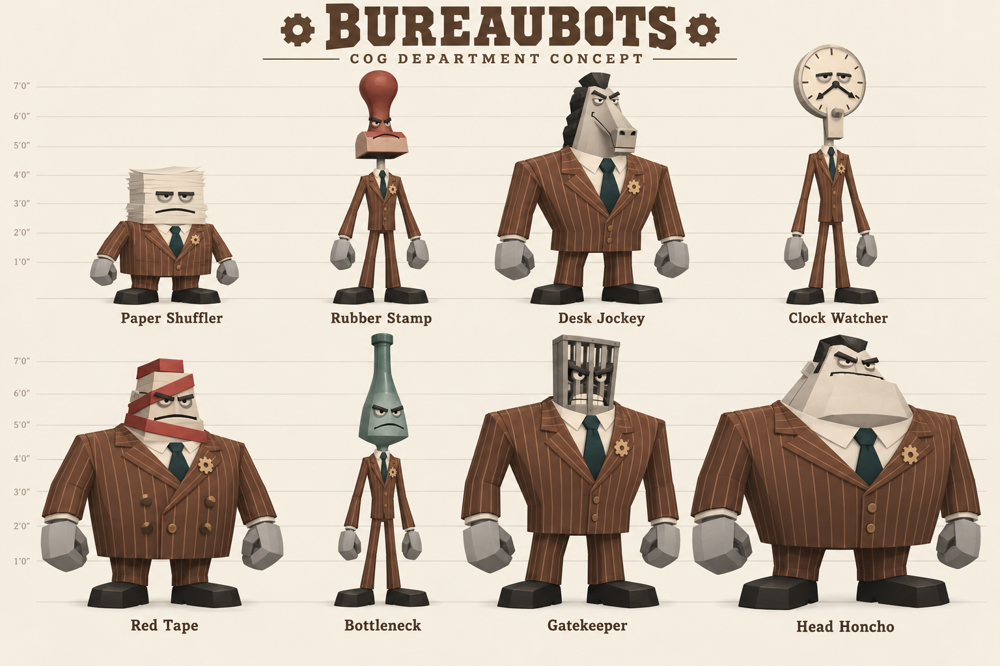
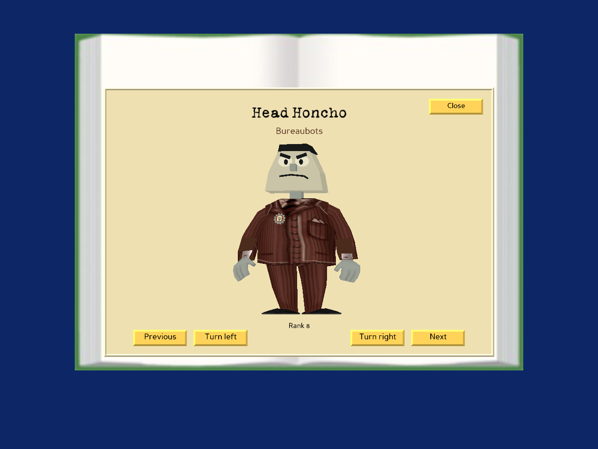

# Bureaubots — Cog department concept

An eight-Cog bureaucracy department inspired by the proportions, business suits, and visual wordplay of the existing Toontown Cogs.

Status: implemented as eight animated gallery models and a fifth Shtickerbook row. The image below is the original AI-generated concept sheet; the actual Panda3D renders follow. These are gallery models, not roaming/battle enemies.

## Implemented previews

The page preview runs the production `SuitPage` with a local test avatar and OTP service adapters. It is not a multiplayer login capture. Each new card opens the named full-body actor, with previous/next and turn controls. The department emblem is shared between the row and the models' lapels.

## Lineup

| Rank | Name | Head design | Body silhouette |
| --- | --- | --- | --- |
| 1 | Paper Shuffler | Crooked stack of paper with sleepy eyes and a frown | Short and stocky |
| 2 | Rubber Stamp | Wooden stamp handle with a stern rectangular chin | Narrow and upright |
| 3 | Desk Jockey | Angular mechanical horse face and flat black mane | Broad shoulders |
| 4 | Clock Watcher | Analog clock face with clock-hand moustache | Tall and thin |
| 5 | Red Tape | Angular face wrapped in red bureaucratic ribbon | Heavyset, double-breasted suit |
| 6 | Bottleneck | Long sea-green bottle-shaped metal head | Tall and narrow |
| 7 | Gatekeeper | Steel barred face with glaring eyes | Imposing inverted triangle |
| 8 | Head Honcho | Oversized square chin, slick hair, raised eyebrows | Largest, barrel-shaped body |

## Shared visual direction

- Muted copper-brown suits, cream pinstripes, ivory shirts, and dark teal ties.
- A small gear-shaped department badge; a clipboard motif can be refined during modeling.
- Simple angular heads, oversized mechanical hands, and broad flat black shoes.
- Early-2000s low-poly geometry and simple painted textures, keeping the original Cog body language.
- Full-body neutral front or three-quarter views with a visible name for every character.

## Production notes

The concept sheet's height guides are illustrative, not final measurements. The implemented actors use the game's existing body proportions, pinstripe textures, and neutral/walk animations, with eight new low-poly heads. Editable model source and individual head/full-body BAM exports are documented in [the model guide](../assets/bureaubots/README.md). Exported BAM textures are embedded for portability.

The existing 32 progression slots and four networked department tracks are preserved. Bureaubot cards show “View model” instead of fictitious defeat quotas. Balance, attacks, street encounters, new saved progression, summons, disguises, and a department boss are outside this gallery/model change.

Validation: model geometry checks; neutral/walk animation binding and head-joint motion for all eight actors; rendering the production gallery; all eight viewer choices, turning and navigation; legacy radar toggles; mixed discovery/progress statuses; exit/re-entry and cleanup. The full OTP-enabled client/server session still needs verification on the game installation.

The preview was generated with the built-in image-generation tool. The exact generation prompt is retained in [bureaubots-prompt.txt](concepts/bureaubots-prompt.txt).
