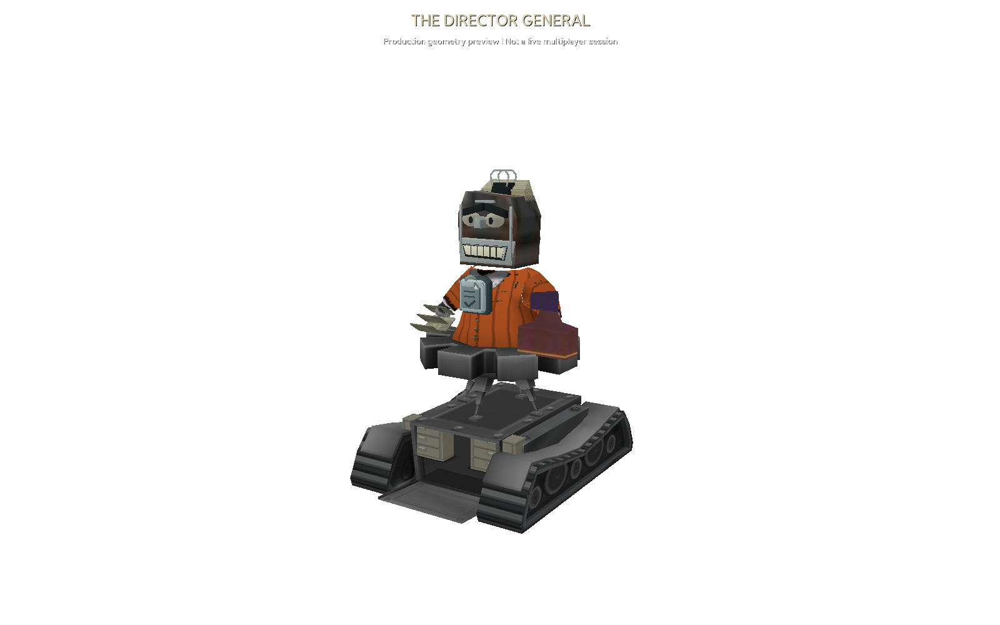
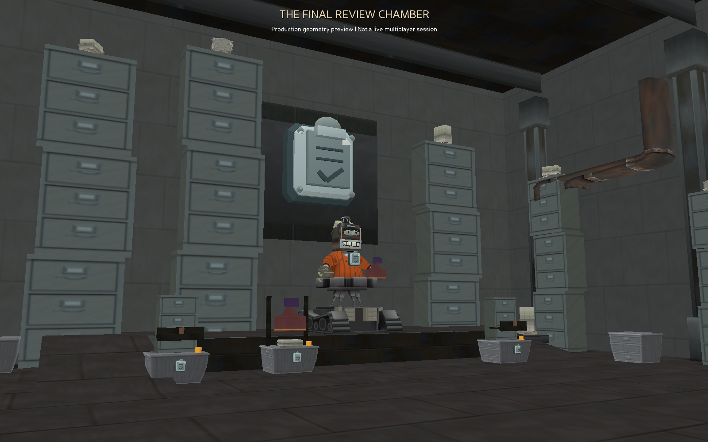
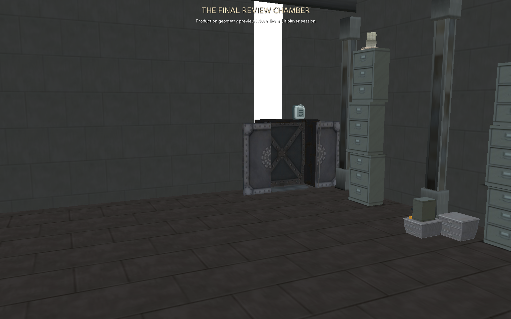

# Director General — first playable implementation

Enter the **FINAL REVIEW** elevator at the north end of Ministry Plaza (14000).
The original eight-seat boss elevator and boarding-group system create a private
dynamic instance. One to eight Toons can enter while suit progression is unfinished.
Restart the AI, state server/DC consumers and clients together: three new DC classes
were appended to `etc/toon.dc` without renumbering existing classes.

## Encounter

1. Arrive in an eight-seat native Cog elevator and walk out into the Final Review Chamber.
2. Defeat upper-rank Bureaubots, levels 9–12. Parties up to four stay together;
   larger groups split into two teams of at most four using `DistributedBattleFinalAI`.
3. Defeat a second wave of level 9–12 Bureaubot Skelecogs. Composition and level
   vary within the native rank limits, with four active enemies and bounded reserves.
4. The final phase uses the same rules and stamp sequence every run. Collect a
   form from either side table; carry it to either sorter. Three forms in **each**
   sorter overload the approval system. Use the central rejection press during
   the 16-second exposure. Four successful rejections defeat the Director.
   A missed exposure empties the sorters and allows another attempt.
5. Stamp attacks telegraph a red circle for three seconds before dealing 12 Laff
   to players still within its radius. Move out of the marked area. Attacks pause
   during an overload; an already announced stamp can still land.
6. Victory grants the normal accumulated gag experience and Cog quest/gallery
   credit, then returns the group to Ministry Plaza. No new boss-specific reward
   or suit promotion is granted yet. Defeat uses the existing safe-zone return.

The proximity button uses native rounded button art. It does not capture chat
keys. The AI validates instance membership, current phase, Laff, zone, distance,
form ownership and action cooldown. Damage and victory cannot be supplied by clients.
Empty/disconnected instances release their battles, suits, tasks and dynamic zone.

## Art

The Director reuses the original boss skeleton, animation clips, tread meshes,
hydraulics, torso, hand geometry and sounds. A custom faceted filing head, binder
clip, paper hair, clipboard chest emblem, stamp and folded forms dress that rig.
The native cloth atlas is edited in memory for copper fabric and pinstripes.
Native filing drawers decorate the chassis. No new generic Blender rig is used.

The chamber uses original Lawbot pillars, cabinets, paper stacks and stone,
Cashbot pipework, factory metal and the full-size Cog elevator. Unequal ramps,
an offset dais, uneven cabinet banks and a storage gallery frame the clear
central battle apron. Background props do not carry display-building nameplates.

## Verification and limits

`PYTHONPATH=tests:. python -m unittest test_bureau_boss test_bureau_hq`
checks rules, native battle adapter behavior, stage callbacks, admission routing,
DC parsing, instance cleanup, model joints and production collision clearances.
`python tools/preview_bureau_boss.py` renders the production geometry and actor.

This workspace has standard Panda3D, but lacks the project's native OTP/Toontown
engine extensions. The previews are **headless scene renders**, not a live
multiplayer run. The automated checks do not substitute for the following tests:

- Board alone, as a party of four, and as a party of eight; leave/rejoin during countdown.
- Check arrival seat placement, elevator doors, walking-out movie and camera reset.
- Complete both waves, including one team finishing first; verify reserve joins,
  Skelecog art, gag UI, health and normal reward accounting.
- Collect, deliver, overload, miss one exposure, dodge stamps and win. Check
  remote players' carried forms, HUD state and return to Ministry.
- Test defeat in each phase, disconnect during boarding/waves/final phase,
  and the last player leaving. Confirm no instances or intervals remain.
- Check the original four bosses and a normal street building after this update.

