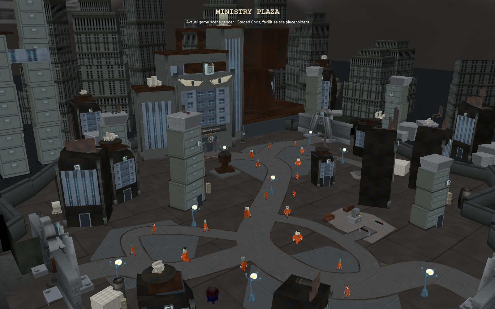
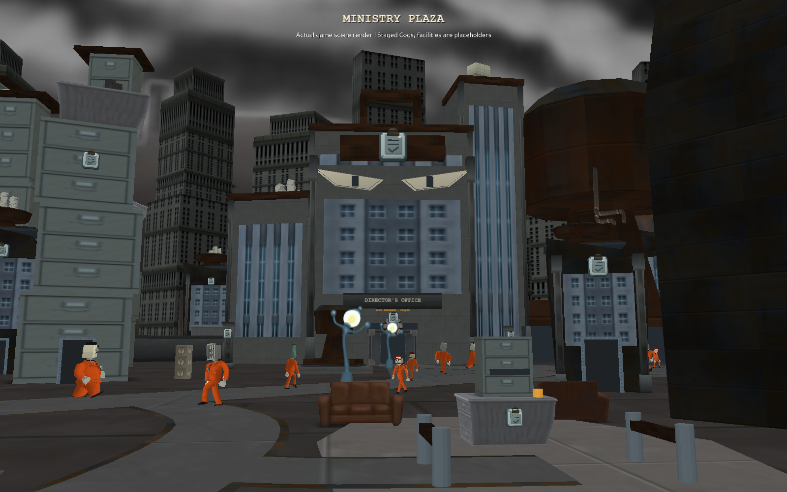
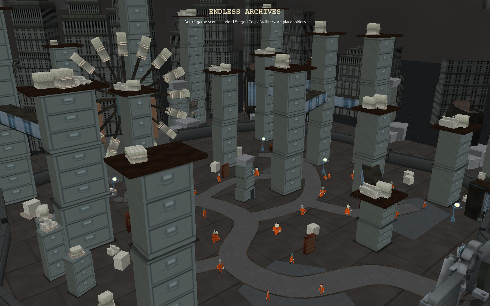
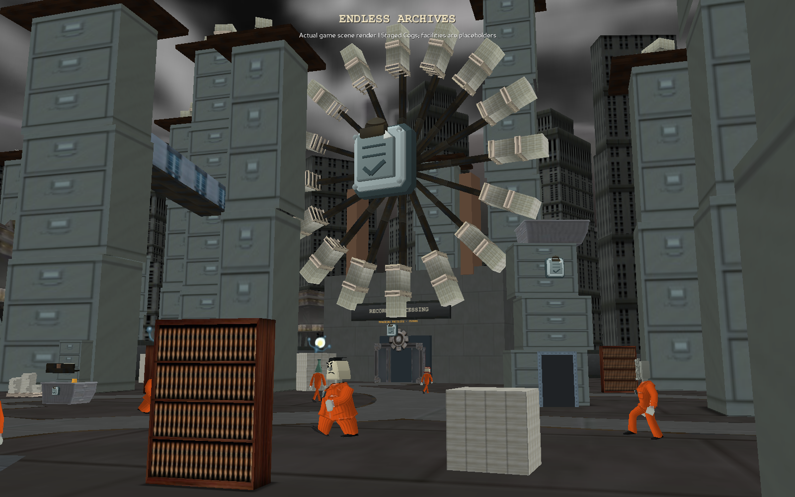
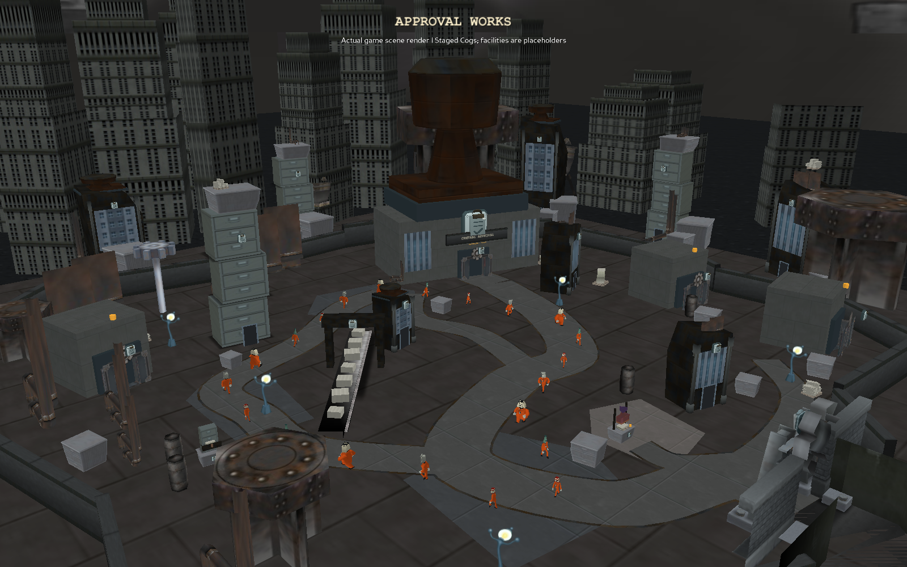
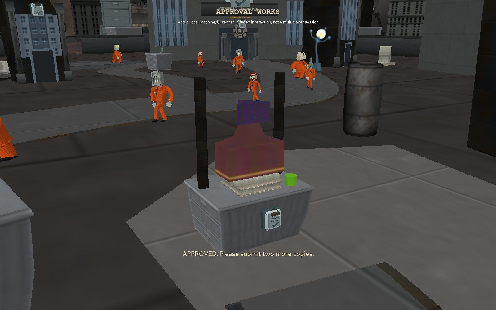
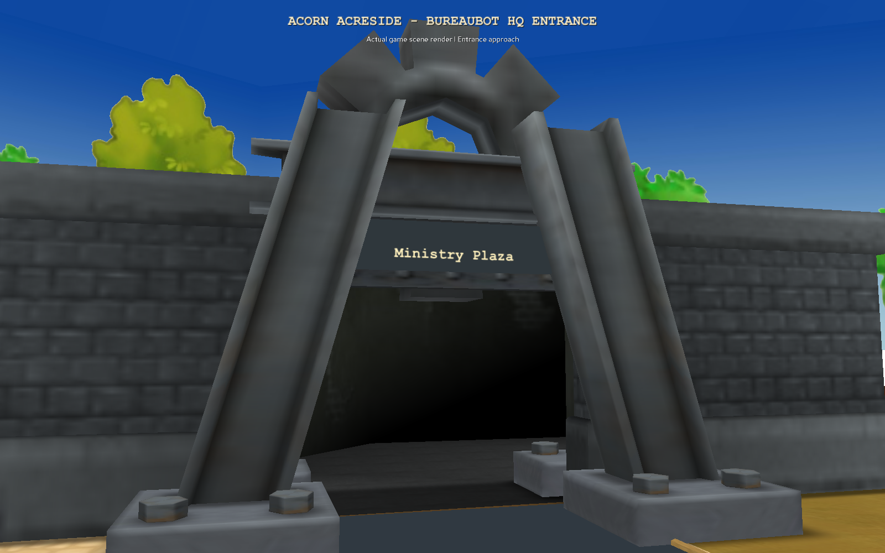
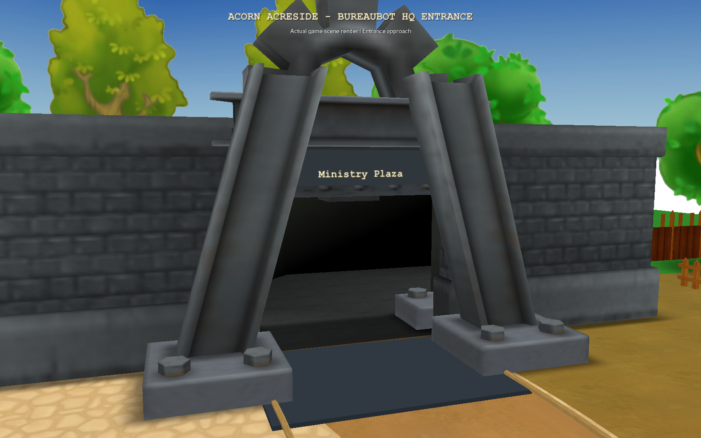

# Bureaubot HQ: first playable-layout pass

Three editable environments share the existing native
tunnel and street-battle systems. This is a native-asset art pass for visual
review. A first Director General encounter is now connected; full progression
and live multiplayer validation remain outstanding (see BUREAUBOT_BOSS.md).

## Layout and access

| Zone | Area | Connections and reserved features |
| --- | --- | --- |
| 19000 | Acorn Acreside | New east-side gateway to Ministry Plaza |
| 14000 | Ministry Plaza | Arrival south; Archives left; Works right; eight-player boss elevator north |
| 14200 | Endless Archives | Return tunnel to Plaza; closed Records Processing training entrance |
| 14300 | Approval Works | Return tunnel to Plaza; closed Central Approval and inspection stations |

The three new IDs are in the existing static HQ range, below dynamic instances.
The admin destination list includes all three. No access rank is required to
walk through the physical tunnels. Defeat returns Toons to safe Acorn Acreside.
Restart clients and AI together after updating the branch.

The revised Plaza has an offset arrival court, records court and Ministry
forecourt separated by staggered industrial annexes. The left Archives gate
is at y=-15; the right Works gate is at y=95, so they do not form a central
four-way crossing. A concave visible floor follows the irregular perimeter.
The document hall uses three uneven, angled volumes and a binder-clip roof, with the
future boss/grouping position on the bending main approach. Filing-cabinet towers
mark the left skyline and the giant stamp marks the right. The same cabinet
and stamp meshes recur in their destination zones. The original gray Cog HQ
tunnel replaces Toon gateways throughout the campus and at the Acorn entrance.
Its authored origin, floor/wall collisions and trigger are retained; the trigger
is renamed for the existing travel hooks. Cast clipboard crests identify the campus.

Archives has thirteen uneven drawer towers, including six interior towers, four
angled skybridges and a rotary card registry. Its branching aisles lead to
sorting pockets and a northwest training entrance, with a cross-aisle shortcut.
Bookshelves, paper stacks and intake annexes dress the interior as well as the edges.
Works has three staggered production yards along a dogleg service road, a
diagonal paper conveyor, interior control/quality/dispatch buildings, inspection
booths, pipes and a stamp-shaped roof landmark shifted to the northeast.
Receiving and service lanes branch toward separate work areas. These replace
the matching paired road loops; Ministry retains its offset sequence of courts.
Steel, aged copper, paper tones and existing painted materials unify the areas.
The square courtyards are replaced by irregular outlines, winding circulation
and smaller side routes. Ministry has a sheltered waiting nook and separate records
loading yard; Archives has cabinet aisles and sorting pockets; Works has an
offset processing hall, machinery yard and staggered inspection stations.

The scattered Archives arrangement is expanded into the main area. Ministry's
green shrubs, planter trees and potted plant are removed. All three zones now
use dark native factory-floor paving instead of yellow playground sidewalks.
Layered outskirts surround all sides: textured ground, inward-facing industrial
annexes, freight crates, water towers and pipework, then a taller skyline.
Extra archive towers and paper pallets dress the Archives borders; Works gets
additional processing machinery and an outer conveyor. The native sky retains
its original scale to avoid far-plane clipping. This remains an unpublished
visual-review pass pending user feedback.

## Original Toontown art reuse

Shared scenery now loads actual resource models with their authored textures
and UVs, not primitive stand-ins or generated lookalike images:

- Dreamland streetlamps/mailbox.
- Filing, ventilation and press annexes built from dark Cog textures, native
  cabinet sections, Cog window/door modules, Cashbot pipes and industrial props.
  The colorful Toontown Central/Dreamland buildings are removed from all three
  areas. Stone and cabinet architecture use a consistent cool charcoal palette.
- Original gray Cog HQ tunnel model with visible destination signs and crests.
- Original street iron fences and Cog facade/window modules.
- Lawbot filing cabinets, bookshelves, couch, boxes, paper stacks,
  wall panels, columns and correctly oriented skyline geometry.
- Stock Cog elevator/door art with Bureaubot crest overlays; legacy logos removed
  where separable. Training/operations doors remain placeholders; the Ministry
  boss entrance now uses a native eight-player distributed elevator.
- Cashbot pipework; Sellbot crates/gears/mixer; original conveyor geometry.
- Existing painted paving, factory-floor, stone and metal textures.

Unique document/stamp/registry structures remain editable custom assemblies.
The existing Cog actor animation clips are unchanged; no substitute Blender
animation rig or new generic character motion is introduced. Local scenery
animation now moves conveyor packets and a factory gear, with six usable
machines described below. Final art polish and live-client review are still needed.

## Gameplay included

- Native AI-owned suit planners, fly-in/walk/fly-out patrol graphs and native
  battle dispatch in all three areas; configured population 18–24, levels 8–10.
- Explicit 100% Bureaubot department weights, unaffected by global invasions or
  the global default-suit override for ordinary HQ spawns.
- Four collision-checked battle locations per area; nearest location selected
  when a battle starts. Patrol graphs follow the revised layouts, with clearance
  around the new interior buildings, conveyor and sorting props.
- Existing Bureaubot DNA, attacks, sound, dialogue and ordinary battle rewards
  continue through the shared suit/battle code.
- No takeover buildings, shop NPCs, trolley, or fake service interiors in HQ.

## Deliberately deferred

Repeatable Archives instance;
training objectives and suit-part rewards; Approval Works progression; final
environment polish, broader ambient audio and dedicated HQ map art.
The training and operations doors are physically closed and labeled as placeholders.
The Ministry grouping pads now lead to the Director General encounter. The older tour previews stage
21 Cogs along the patrol route, matching the configured population midpoint;
they are not evidence of a connected multiplayer session.

## Courtyard detail and interaction pass

- Ministry: moved the obstructing arrival annex off the central vista; added a
  queue court with seating, ticket dispenser, and a separate certification nook.
- Archives: replaced the foreground tower with a lower, offset bank, lowered its
  bridge, moved a bookshelf off the facility entrance view, added stepped west
  storage and two working catalog/registry alcoves. Tower roofs vary in paper
  load, number of bundles, angle, height and pipe details.
- Works: moved the entry mixer into the western service yard, lowered the control
  and quality buildings, added a separate test-press apron, conveyor gantry,
  dispatch drawer, freight loads, and staggered utility runs along the rear edge.
- All three retain original Toontown assets and textures. Annex roof cargo and
  vents vary. No display-only annex or inspection booth has a nameplate; only
  future Director's Office, Records Processing and Central Approval facilities,
  plus travel tunnels, retain destination signage.

The six optional machines use a proximity click button with native GUI art:
ticket dispenser and form stamp in Ministry, catalog drawer and registry wheel
in Archives, test stamp and dispatch drawer in Works. Each plays an existing
Toontown sound and animates its own art while keeping the collision footprint
fixed. They give local flavor text only, no rewards, progression or networked
state. The server remains authoritative for Cogs, battles and travel.

`BureauHQDetails.py` assembles the props. `BureauHQInteractions.py` manages their
animations and UI on place entry/exit, with unload cleanup as a fallback. It
rechecks proximity and walk state on click, uses a four-second cooldown, hides
controls in every non-walk state, and cancels/reset actions on battle entry.
It never binds a keyboard key or changes avatar controls/chat. Conveyor and gear
intervals, sound, GUI and tasks are stopped when leaving/reloading the place.

Sixteen HQ tests now include machine approach clearance, real Panda3D interval
movement, cooldown/range/battle gating, reset and task cleanup, absence of display
building nameplates, and entry sightline rays to both landmarks and facility
doors. Existing patrol, battle-pad, exploration-route and tunnel checks remain.
Walking-height and elevated renders are inspected separately because collision
rays alone cannot catch every visual obstruction.

Generate the current detail views and optional machine/UI captures with:

```sh
python tools/preview_bureau_tour.py --zone 14000 --revision detail5 --interactions
python tools/preview_bureau_tour.py --zone 14200 --revision detail5 --interactions
python tools/preview_bureau_tour.py --zone 14300 --revision detail5 --interactions
```

## Editing and previews

- `toontown/expansion/BureauHQGlobals.py`: zone IDs, gates, spawns, patrols, pads.
- `toontown/expansion/BureauHQScene.py`: shared live-client and preview geometry.
- `toontown/expansion/BureauHQDataAI.py`: native AI startup and planner registration.
- `tools/author_bureau_hq_patrols.py`: regenerate committed native patrol DNA.
- `tools/preview_bureau_hq.py`: render arrival/overview/detail images in `docs/previews`.
- `tools/preview_bureau_native_kit.py`: inspect the original reusable resource kit.

Run from the repository root with the usual resources checkout mounted:

```sh
python tools/author_bureau_hq_patrols.py
python tools/preview_bureau_hq.py
python -m unittest discover -s tests -p 'test_bureau_hq.py'
python -m unittest discover -s tests -p 'test_bureaubot*.py'
python -m unittest discover -s tests -p 'test_expansion.py'
```

## Validation and remaining live checks

The Acorn entrance scenery has been cleared: Seed Money is relocated to the
north court, picket fences sit beyond the Cog tunnel wings, and the eastern
trees form a backdrop behind the complete tunnel footprint. The terrain has
a connected entrance path and a wider boundary opening. The tunnel transform,
destination, trigger and return connections are unchanged. Clearance checks now
cover the doorway width through the travel trigger and the actual visible bounds
of nearby scenery, including props with incomplete native collision meshes.

Sixteen HQ tests cover reciprocal travel, ID reservations, population settings,
reproducible connected patrol graphs, real floor/wall collision, battle pads,
Acorn's approach, actual native tunnel-hook request construction, AI startup,
invasion bypass, defeat routing, native asset reuse, dark paving, dressed outskirts,
staggered Plaza exits and collision clearance along the new explorable routes
and every generated patrol edge. Native-dependent methods use narrow
harnesses; the native DNA parser/network session is not simulated.
The existing 17 Bureaubot tests and six expansion routing tests also pass.

The older `test_authored_walking_routes_and_oak_passage_are_clear` has 17 failing
subcases on Acorn/Root Route. These were reproduced using the HEAD version of
ExpansionScene without the new gateway; this change does not repair those old
route/geometry discrepancies.

This environment has standard Panda3D but lacks `panda3d.toontown` / native OTP,
so a full client/AI session has not been run. Before treating this as playtested:

1. Start a district and client with the custom Toontown engine; inspect AI
   startup for native patrol DNA parsing/path-generation errors.
2. Walk Acorn → Plaza → Archives → Plaza → Works → Plaza → Acorn. Check both
   tunnel movies, return orientation, camera collisions and reload cleanup.
3. In each area, wait for live suits, start and finish a battle, verify normal
   battle rewards and regeneration, then repeat during a non-Bureau invasion.
4. Test defeat return to Acorn, teleport out/in, and two-client visibility.
5. Test the boss entrance using BUREAUBOT_BOSS.md. Training/operations doors
   remain closed and award no suit parts.
6. Use each scenery machine, open chat/the book, enter battle during an action,
   and leave/re-enter the zone. Confirm input remains normal, prompts disappear,
   and there are no leftover UI, sound or intervals. Check the denser population
   and scene performance on the target client; neither is benchmarked here.









