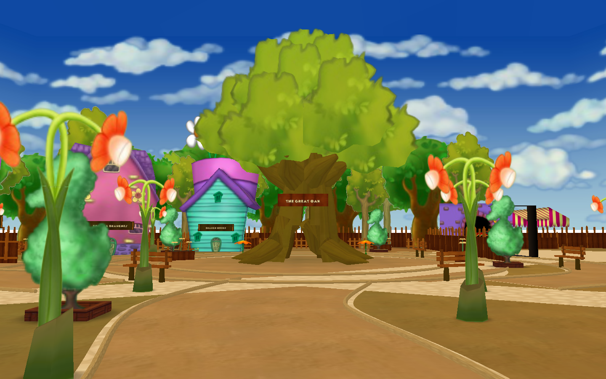
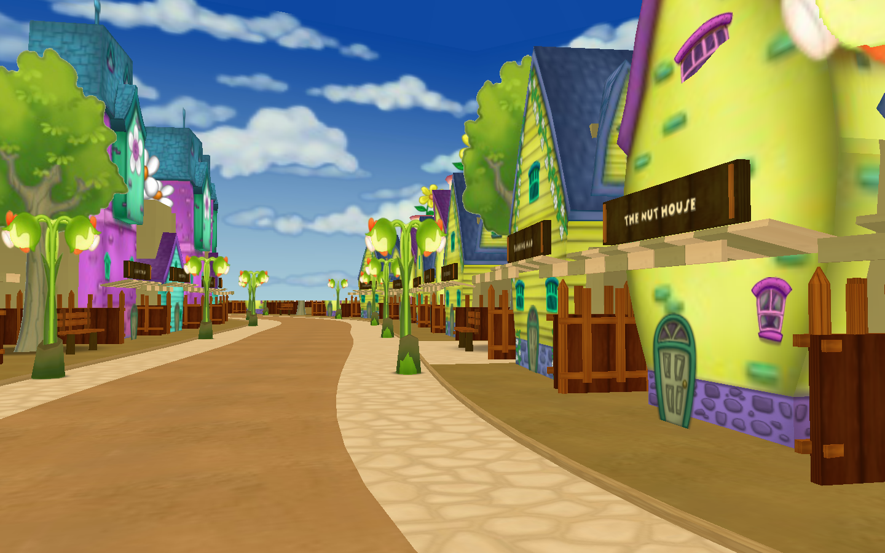
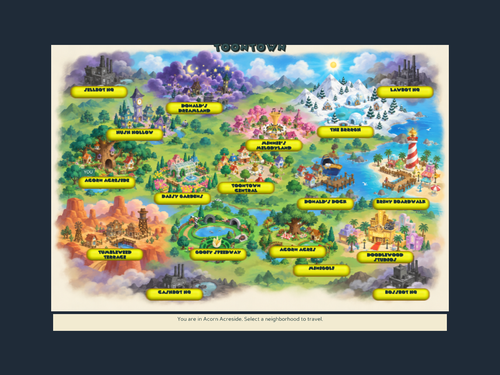
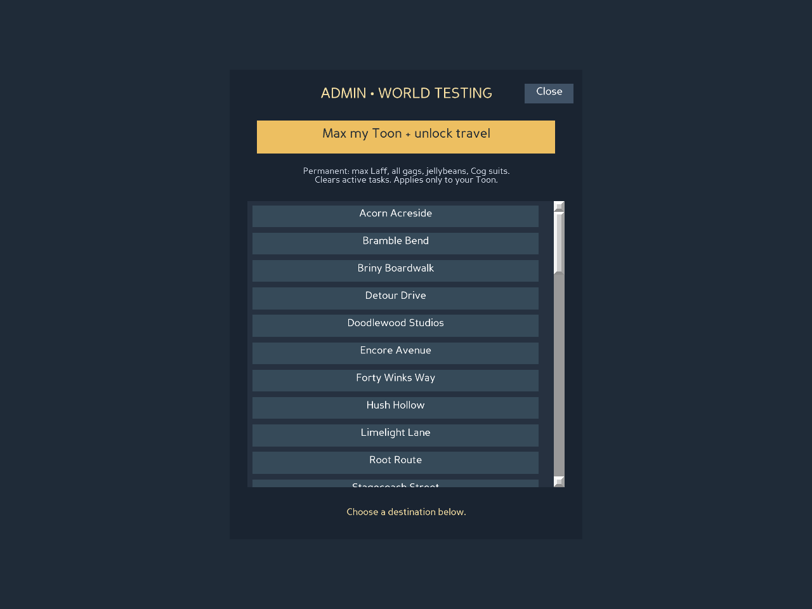

## Street and playground finishing pass

- Streets have only Toon HQs; gag-shop interiors, clerks and trolleys are playground-only.
- Distinct perimeter fences and screened building/service yards have collision walls.
- Woodland earth, coastal sand, purple garden brick, studio paving and desert dust replace generic grass.
- Grounded prop aliases share level walking surfaces; deterministic clusters add benches, planters, palms, barrels, cameras and cacti.
- All eight streets have longer curved centerlines and native server-owned Cog patrols (8–14 per street). Native battle states/UI are connected; decorative buildings cannot be taken over.
- Hold Shift for 1.65× walking speed. Physical arrow polling preserves turning and the following camera while Ctrl-jumping.
- The world map no longer draws connecting route lines.

Scenes were rendered for visual review; no test suites were run. The custom Mac engine is unavailable on this host, so the client/AI gameplay changes still need a live walkthrough. Restart the complete local stack after pulling.

## Full world art update

The remaining four playgrounds and seven streets have been rebuilt with native
DNA, original textured modules and new themed models. The Shtiker map is now one
illustrated world with original and expansion destination buttons. See the
[art kit, screenshots and editor guide](../assets/expansion/README.md).

The test suite was not run for this update, as requested. Scene/UI previews were
rendered for visual iteration; a live custom-engine walkthrough remains outstanding.

# Beyond the Tunnels — first exploration build

Five new neighborhoods and eight connecting promenades extend the existing
world. This is a first playable implementation for layout testing, not a finished
quest/content expansion. New areas have authored native DNA scenery, native street Cog patrols,
landmarks, collisions, music, and two-way native tunnel travel.

**Art rebuild:** Acorn Acreside and Root Route now load editable native DNA,
textured Toontown storefronts and props, and custom modeled terrain and a hollow
Great Oak. Root Route has a curved road, sidewalks and pocket courtyards. All remaining neighborhoods and streets now use the expanded art kit as well.
See [the Acorn art kit and editor instructions](../assets/acorn/README.md).

## Locations and routes

| Playground | Zone | Design | Entrance from the original world |
| --- | --- | --- | --- |
| Acorn Acreside | 19000 | Autumn trees, a hollow Great Oak, timber storefronts | Daisy Gardens → Root Route |
| Briny Boardwalk | 61000 | Wooden boardwalk, pastel shops, lagoon, striped lighthouse | Donald's Dock → Taffy Terrace |
| Hush Hollow | 62000 | Plum and teal buildings, pumpkin props, crooked clock tower | Donald's Dreamland → Forty Winks Way |
| Doodlewood Studios | 63000 | Theater, film reel, red carpet, backlot facades | Minnie's Melodyland → Encore Avenue |
| Tumbleweed Terrace | 64000 | Adobe storefronts, cacti, dry creek, hat-shaped water tower | Goofy Speedway → Detour Drive |

Bramble Bend connects Acorn Acreside and Hush Hollow. Limelight Lane connects
Briny Boardwalk and Doodlewood Studios. Stagecoach Street connects Doodlewood
Studios and Tumbleweed Terrace. Every connection has a return tunnel.

Open the Shtickerbook map to see all original and new neighborhoods together.
Visiting a new neighborhood unlocks its playground teleport. The illustrated
map has directly selectable labeled buttons and curved route overlays.

## Admin testing

The **Admin** button appears in the upper-right while walking with an account
whose existing server-assigned access level is ADMIN (300) or SYSTEM_ADMIN (400).
It hides during battles, transitions, boarding groups, and other activities.
This change does not alter account roles or the login provider's default role.

**Max my Toon + unlock travel** uses the existing server max-toon routine:
137 Laff, all seven gag tracks and maximum experience, maximum gag capacity,
full inventory, jellybeans/bank, four task slots, maximum Cog disguises, final
quest tier, and travel access. It permanently clears the active task list.
It does not award every fishing/gardening/racing collectible or cosmetic.

The scrollable destination list includes the new playgrounds and promenades,
original playgrounds, Cog HQ exteriors, factory exterior, MiniGolf, and all 17
original streets. Original street teleports arrive through their actual playground
tunnel instead of carrying over coordinates from another zone. Instanced battles,
private estates, and unallocated zone IDs are intentionally not listed.

Requests affect only the authenticated sender's Toon. The AI independently checks
ADMIN access, the action and destination allowlists, tutorial state, and a one-second
rate limit. Mutations use the existing server setters and are logged. Editing a
client or making the button visible cannot grant admin access.

Finish or use the game's existing skip option for the introductory tutorial first;
the testing controls are available once walking in the world. No progression
through the main game is needed.

## Running this branch

1. Keep the resources checkout described in the main README. No separate resource
   repository edits are needed. The Acorn models are included under `assets/acorn`;
   keep both `assets/acorn` and `assets/expansion` with the game checkout.
2. Stop the game client, AI, UberDOG, and Astron. Update all of them to this branch.
3. Restart in the normal order: Astron → UberDOG → AI → client.
4. Open **Admin**, max the test Toon, and select **Acorn Acreside** (or any other
   listed location). Use the physical tunnels to exercise the complete route graph.

A full restart is required: `etc/toon.dc` adds an RPC and the dynamic allocator now
starts at **65000**, reserving **61000–64999** for static neighborhoods. Existing
Welcome Valley and legacy 20000–21999 mappings are unchanged. Do not mix old and
new clients/servers or hot-reload this into a running district with allocated
instances in the reserved range. No saved Toon IDs or account IDs are renumbered.

The project still requires its custom Panda3D fork with `panda3d.otp` and
`panda3d.toontown` to play. Standard Panda3D can render the scene/UI previews and
run geometry tests, but cannot run the complete legacy client/server.

## Previous validation (before this update)

- `python -m unittest discover -s tests -v` — 17 checks covering all reciprocal
  routes, reachability, static/dynamic boundaries, the actual routing functions,
  permission denial, the actual admin RPC with fake transport, rate limiting,
  scene construction, tunnel origins, authored walking routes, the hollow oak
  passage, floor/wall collision probes, and portable model texture references.
- Both `etc/otp.dc` and `etc/toon.dc` parse with Panda3D's DCFile parser.
- All 17 original street arrival visgroups were checked against resource DNA.
- `python tools/preview_expansion.py` renders the actual five neighborhood scenes.
- `python tools/preview_acorn.py` renders Acorn and Root Route from overview and
  walking-height cameras. Their storage and layouts also passed the Python DNA
  parser bundled with OpenLevelEditor; native-loader/editor-GUI testing remains.
- `python tools/preview_expansion_ui.py` renders actual UI widgets with mock avatar
  state; it is not a multiplayer session.
- Source entrance floor/wall probes use the original neighborhood terrain models.
  They do not include every DNA-placed prop, NPC, or distributed building.

Full client/AI integration, travel movies in a live district, multiplayer visibility,
reconnect/persistence, and source entrances with the complete DNA scene still need
an in-game pass using the custom engine. Keep the PR in draft until that pass.

## Remaining content work

Every new area has a Toon HQ. Gag shops and trolleys are playground-only, with
quest officers, clerks, door wiring and stock minigame flow.
Other decorative shop fronts remain scenery. New bespoke NPC task chains, Cog
buildings, fishing gameplay, ambient animations, custom music and further
art/terrain polish remain future work. The
lagoon and creek are visual scenery. Existing game content is unchanged.

